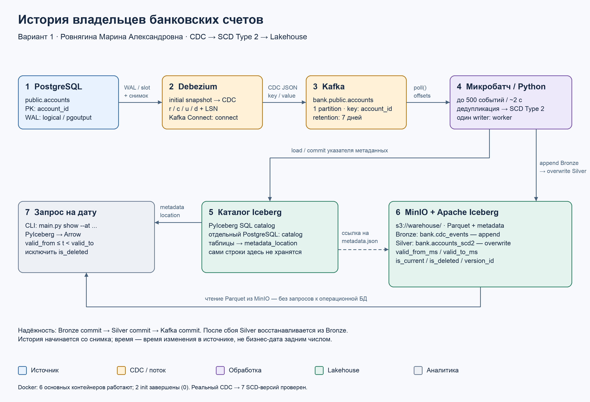

# Отчёт по практической №2

## 1. Вариант и задача

| Поле | Значение |
| --- | --- |
| ФИО (как в VK Education) | Ровнягина Марина Александровна |
| Тема | 1. История в справочнике: CDC → SCD → Lakehouse |
| Состав решения | PostgreSQL 16 → Debezium PostgreSQL Connector / Kafka Connect → Kafka KRaft → Python-микробатч с PyIceberg → Iceberg-таблицы в MinIO; отдельный PostgreSQL для SQL-каталога; чтение через PyIceberg / Arrow |
| Данные, объём | Вымышленный справочник банковских счетов `public.accounts`: `account_id`, `owner`, `city`, `status`. Старт: 2 строки; сценарий: 3 обновления атрибутов, 1 обновление без изменения значения, 1 удаление, 1 вставка. Фактически получены 8 событий Bronze и 7 SCD-версий. Это функциональный пример, нагрузочные измерения не проводились. |

**Задача:** ответить, кто владел счётом и какой статус он имел в заданный момент, не выполняя аналитические SELECT к операционной БД. Первоначальный снимок читает таблицу один раз; последующие изменения читаются из WAL. CDC не устраняет нагрузку полностью: остаются snapshot, logical decoding и удержание WAL replication slot. Такой порядок начального снимка и последующего чтения WAL описан в [документации Debezium PostgreSQL](https://debezium.io/documentation/reference/3.3/connectors/postgresql.html).

**Выбран SCD Type 2.** При изменении владельца, города или статуса старая версия закрывается, новая получает собственный идентификатор и интервал. Бизнес-ключ — `account_id`, ключ версии — `version_id`, вычисленный из идентификатора CDC-события. `version` — порядковый номер версии внутри счёта.

| Тип | Когда подходит | Применимость к задаче |
| --- | --- | --- |
| Type 1 | Хранить только последнее значение, например исправлять опечатки без истории | Теряет предыдущего владельца и не позволяет ответить на дату |
| Type 2 | Сохранять все изменения с интервалами действия | Основной выбор для истории счёта |
| Type 3 | Хранить ограниченное предыдущее значение в отдельной колонке | Недостаточно для произвольного количества смен владельца |
| Type 6 | Совмещать Type 2 с колонками текущего и предыдущего значения | Возможен для удобных витрин, но здесь дублирование атрибутов избыточно; текущие строки выбираются через `is_current` |

Выбрана обработка **микробатчами**, до 500 Kafka-сообщений примерно раз в 2 секунды плюс время обработки. Частые одиночные записи создавали бы много маленьких файлов и коммитов. Суточный batch давал бы слишком большую задержку. Python выбран для маленького учебного примера; Spark Structured Streaming в данном стенде не используется. На больших объёмах тот же принцип переносится в Spark с обработкой всех изменений затронутых ключей и идемпотентным `foreachBatch`.

## 2. Источники и способы сбора

| Источник | Тип | Способ сбора и причина |
| --- | --- | --- |
| `source.bank.public.accounts` | Snapshot → CDC | Debezium делает начальный согласованный снимок, затем читает logical WAL через `pgoutput`. `table.include.list` ограничивает захват одной таблицей. Постоянный polling SELECT не нужен. |
| WAL PostgreSQL | CDC | Replication slot `bank_slot` и заранее созданная publication `bank_publication`. `REPLICA IDENTITY FULL` сохраняет старые значения для удаления; CDC-роль имеет SELECT и REPLICATION. |
| `bank.public.accounts` | Поток Kafka, промежуточный транспорт | Потребитель читает JSON `before/after`, `op`, `source.lsn`, `source.ts_ms`, `transaction`. Ключ — PK счёта. Одна партиция сохраняет порядок; retention задан 7 дней. |

Внешние API, документы и векторная БД для этой задачи не нужны. Kafka и WAL — этапы доставки одного источника, а не независимые бизнес-источники. Дополнительная PostgreSQL `catalog` хранит технический каталог Iceberg.

## 3. Архитектура (draw.io)



Исходник: [architecture.drawio](architecture.drawio). Все стрелки подписаны; цвета источника, потока, обработки, Lakehouse и аналитики объяснены легендой. Пунктир обозначает ссылку каталога на метаданные, а не перенос строк данных.

| Блок схемы | Для чего нужен | Где описан |
| --- | --- | --- |
| PostgreSQL-источник | Операционные записи и WAL | `source` в Compose; `sql/01-source.sql` |
| Debezium / Kafka Connect | Преобразовать WAL в CDC-события | `connect`; `config/connector.json` |
| Kafka | Буферизовать события, сохранять порядок, позволять повторное чтение | `kafka` в Compose |
| Микробатч / SCD Type 2 | Дедуплицировать и построить интервалы истории | `worker/main.py`, `worker/scd.py` |
| Каталог Iceberg | Разрешать имя таблицы в указатель на её метаданные и фиксировать коммиты | `catalog`; `worker/storage.py` |
| MinIO + Iceberg | Хранить журнал и историю в открытых табличных файлах | `minio`, `bucket-init`; `worker/storage.py` |
| Запрос на дату | Прочитать историю независимо от операционной БД | `docker compose exec ... main.py show --at ...` |

Запрос — отдельный запуск команды внутри `worker`, отдельного постоянно работающего контейнера аналитики нет.

**Lakehouse:** MinIO хранит Parquet, манифесты и JSON-метаданные Iceberg. Сам по себе бакет с Parquet ещё не даёт табличных транзакций: таблицами управляет Iceberg, а каталог фиксирует текущий указатель на метаданные. `bank.cdc_events` — Bronze-журнал с исходным JSON и координатами Kafka; `bank.accounts_scd2` — Silver-история. В демонстрации используется SQL-каталог PyIceberg на отдельной PostgreSQL, поддерживаемый [конфигурацией PyIceberg](https://py.iceberg.apache.org/configuration/#sql-catalog). Lakekeeper и Trino не входят в Compose: чтение выполняет PyIceberg / Arrow.

## 4. Docker — что поднялось (честно)

**22 ноября 2026 года стенд успешно запущен в Docker Desktop.** Работают 6 основных контейнеров; ещё 2 одноразовых init-контейнера завершились с кодом 0. Коннектор Debezium и его task имеют статус `RUNNING`. Сквозной сценарий `scripts/demo.py` завершился успешно.

| Блок | Реализация | Фактический статус Docker |
| --- | --- | --- |
| PostgreSQL-источник | Compose, DDL, тестовые данные и logical WAL | Работает, healthy; изменения выполнялись SQL-командами |
| Kafka | Compose, KRaft, volume, одна партиция | Работает, healthy; передаёт CDC-события |
| Debezium / Connect | PostgreSQL-коннектор, регистрация через REST | Работает, healthy; коннектор и task RUNNING |
| MinIO | S3-хранилище и бакет warehouse | Работает; Iceberg-файлы записаны в бакет |
| PostgreSQL-каталог | SQL-каталог PyIceberg | Работает, healthy; зарегистрированы обе Iceberg-таблицы |
| Worker SCD Type 2 | Python-микробатч и запросы истории | Работает; обработаны 8 CDC-событий, получены 7 SCD-версий |
| bucket-init | Создание бакета | Exited (0), штатное одноразовое завершение |
| kafka-init | Владелец корня Kafka-volume — UID/GID 1000 | Exited (0), штатное одноразовое завершение |

Использованы Docker Engine 28.5.1 и Compose v2.40.0-desktop.1 на ARM64. Основные команды:

```bash
docker compose config --quiet
sh scripts/start.sh
docker ps
docker compose ps -a
python3 scripts/demo.py
docker compose exec -T worker python main.py show
```

### Что мешало запуску и что исправлено

Исходные `minio/minio` и `minio/mc` недоступны для загрузки: Docker Hub вернул `pull access denied`, а Quay.io — `401 UNAUTHORIZED`. Вместо них использована community-сборка `pgsty/minio:RELEASE.2026-08-04T00-00-00Z`, закреплённая digest `sha256:b6bfe7239bfc83fb90d31612d9704d86039dd714f7904b3f1ad68f211e602372`. В неё уже входит `mc`, поэтому один образ используется сервером и bucket-init. Это сборка независимого [проекта PGSTY — форка MinIO](https://github.com/pgsty/silo), а не исходный образ MinIO Inc.

Kafka сначала завершилась с `AccessDeniedException` при записи `bootstrap.checkpoint.tmp`. Новый именованный volume имел владельца root, а брокер работает под UID 1000. Добавлен `kafka-init`, который меняет владельца только корня этого учебного volume; Kafka запускается после его успешного завершения. Эти два init-контейнера — служебные шаги для логических блоков схемы.

### Фактические доказательства

- [docker ps](results/docker-ps.txt) — 6 работающих контейнеров.
- [docker compose ps -a](results/compose-ps.txt) — основные контейнеры и два init со статусом Exited (0).
- [Статус коннектора и task](results/connector-status.json) — RUNNING / RUNNING.
- [Сквозная демонстрация](results/demo.txt) — SQL-команды и результат `PASS: real CDC -> 7 versions; no-op, delete, current and historical query checked`.
- [Фактическая история SCD Type 2](results/history.json) — 7 версий, из них 2 текущие неудалённые; у счёта 1001 — 4 версии.
- [Bronze-журнал](results/cdc-events.json) — 8 событий с исходными JSON Debezium, LSN и Kafka offsets. Tombstone после DELETE не создаёт дополнительную строку истории.
- [Файлы в MinIO](results/minio-files.txt) — Parquet, JSON-метаданные и манифесты Iceberg.

Изменения созданы в операционной PostgreSQL, а не подставлены в worker как тестовые JSON. Данные прошли путь PostgreSQL → Debezium → Kafka → worker → Iceberg / MinIO. Сценарий проверил границы интервалов, обновление без изменения значения, удаление, текущий срез и исторический запрос.

В контейнере PyIceberg выдаёт предупреждение о переходе на Python Avro decoder без Cython-ускорения. Это не остановило обработку; для учебного объёма результат получен. Нагрузочное тестирование не проводилось.

## 5. Описание

| Шаг | Для чего | Результат |
| --- | --- | --- |
| 1. Инициализировать справочник и CDC | Создать PK, publication, logical WAL и роль чтения | Источник готов к захвату изменений |
| 2. Получить начальный snapshot | Зафиксировать известное исходное состояние | События `op=r`; история начинается с этого момента |
| 3. Читать WAL после snapshot | Получать вставки, обновления и удаления без регулярных полных SELECT | События `c/u/d`, LSN и метаданные транзакции |
| 4. Доставить события через Kafka | Отделить источник от потребителя, дать буфер и replay | Упорядоченный поток с PK счёта и Kafka offset |
| 5. Сохранить Bronze-журнал | Иметь возможность восстановить проекцию и не терять промежуточные изменения | Append в `bank.cdc_events`; исходный JSON сохраняется |
| 6. Построить SCD Type 2 | Закрыть предыдущую версию и добавить новую для каждого реального изменения | История с `valid_from_ms`, `valid_to_ms`, `is_current`, `is_deleted` |
| 7. Записать Silver и подтвердить Kafka offsets | Не подтвердить обработку раньше устойчивой записи результата | Атомарный Iceberg overwrite одной таблицы, затем Kafka commit |
| 8. Выполнить запрос на дату | Получить состояние счёта из Lakehouse | Версия, удовлетворяющая `valid_from ≤ t < valid_to`, без удалённых записей |

### Правила истории

- Интервалы полуоткрытые: `[valid_from_ms, valid_to_ms)`, у последней версии `valid_to_ms = NULL`. На каждую запись приходится одна текущая версия, включая маркер удаления.
- Проверяются изменения `owner`, `city`, `status`. UPDATE с теми же значениями сохраняется в Bronze, но новую SCD-версию не создаёт.
- DELETE закрывает активную версию и создаёт текущий маркер `is_deleted=true`; прежняя история остаётся. Kafka tombstone с `value=null` не создаёт вторую запись об удалении. Повторная вставка того же ключа начинает новую активную версию.
- Все изменения одного ключа внутри микробатча применяются последовательно, а не сворачиваются в одну последнюю строку. Так сохраняются промежуточные состояния.
- Время интервалов берётся из `source.ts_ms`; для snapshot при нулевом значении используется время события Debezium. Это техническая история наблюдённых изменений. Бизнес-дату «задним числом» источник не передаёт. Ответить, кто владел счётом до начального snapshot, невозможно.
- При одинаковой миллисекунде порядок задаётся Kafka offset. Предыдущая версия может иметь пустой временной интервал: она остаётся в журнале и истории, а запрос только по времени возвращает последнее состояние этой миллисекунды. Секундной или миллисекундной точности недостаточно, чтобы запросить все промежуточные состояния одной транзакции.

Схематический пример интервалов; реальные timestamps полученного результата сохранены в [history.json](results/history.json):

| account_id | version | owner | city | status | valid_from | valid_to | is_current |
| --- | --- | --- | --- | --- | --- | --- | --- |
| 1001 | 1 | Мария Соколова | Москва | active | t0 | t1 | false |
| 1001 | 2 | Наталья Волкова | Москва | active | t1 | t2 | false |
| 1001 | 3 | Наталья Волкова | Санкт-Петербург | active | t2 | t3 | false |
| 1001 | 4 | Наталья Волкова | Санкт-Петербург | blocked | t3 | NULL | true |

Между второй и третьей версиями изменился город: Москва → Санкт-Петербург. В момент `t1` вернётся уже Наталья; на интервале `[t0,t1)` — Мария.

### Повторы, сбои и ограничения

Kafka offsets подтверждаются вручную после обоих Iceberg-коммитов. Повтор чтения одного Kafka offset не добавляет строку Bronze. Для повторной публикации Debezium используется идентификатор `topic + transaction.id + transaction.total_order`: он не зависит от нового Kafka offset. Соответствующая настройка коннектора включена. Без метаданных транзакции обработчик останавливается, не подтверждая проблемный батч.

Если Bronze уже записан, а Silver ещё нет, при следующем запуске Silver пересобирается из Bronze. Если обе таблицы записаны, но Kafka commit не успел, повторная обработка даёт ту же историю. Каждая запись `append`/`overwrite` создаёт коммит Iceberg, как описано в [API PyIceberg](https://py.iceberg.apache.org/api/#write-support). Общей атомарной транзакции двух таблиц и Kafka нет; Silver может кратковременно отставать. Это at-least-once доставка с идемпотентным построением проекции при одном писателе, а не заявление о сквозном exactly-once.

Учебное упрощение: worker держит весь Bronze в памяти и полностью пересобирает Silver. Для нескольких строк это прозрачно и позволяет проверить восстановление; для большого справочника стоимость растёт с полной историей. В промышленном решении нужны инкрементальная обработка затронутых ключей, MERGE или перезапись нужных партиций, компакция и очистка старых snapshot по политике хранения. Повышение числа партиций требует отдельного переноса с сохранением порядка ключей.

Один брокер и один экземпляр каждого сервиса не обеспечивают отказоустойчивость. Потеря volumes не покрывается прототипом. Нужно следить за lag потребителя, временем удержания WAL replication slot и ёмкостью дисков. Если задержка превысит retention и нужные Kafka-события не попадут в Bronze, потребуются восстановление и сверка. Изменения схемы данных, несколько независимых источников, полноценная обработка поздних бизнес-событий и отката часов здесь не реализованы; при обратном ходе времени обработчик выдаёт ошибку вместо некорректных интервалов.

### Выводы

CDC и SCD решают разные части задачи: CDC доставляет изменения, SCD превращает их в историю, пригодную для запроса на дату. Kafka позволяет повторное чтение, но сама не предотвращает повторные версии — для этого нужны устойчивые идентификаторы и правила обработки. Iceberg даёт табличные коммиты поверх файлов MinIO; каталог связывает имя таблицы с её метаданными. Аналитика читает Lakehouse, поэтому не обращается к операционной таблице.

Проверен реальный CDC-поток: изменение в PostgreSQL приводит к новой исторической версии в Iceberg, прежнее состояние доступно запросом на дату. Получены 8 CDC-событий и 7 SCD-версий; повторный UPDATE с тем же статусом не создал лишнюю версию. Сквозной сценарий прошёл, фактический вывод приложен.
